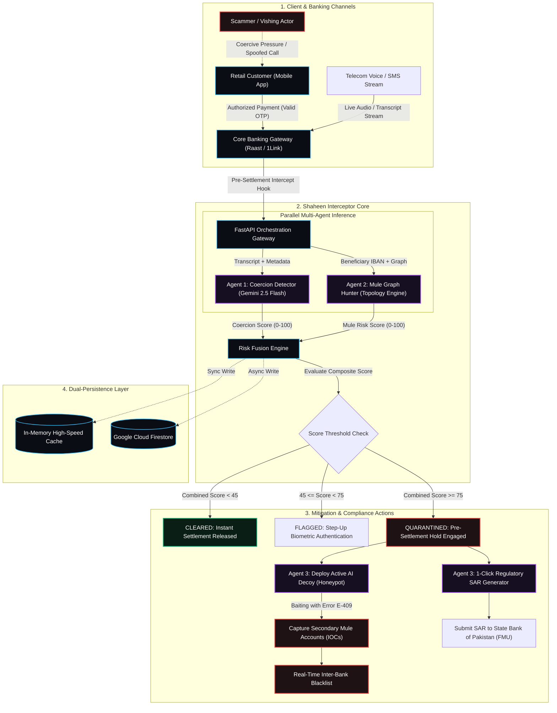
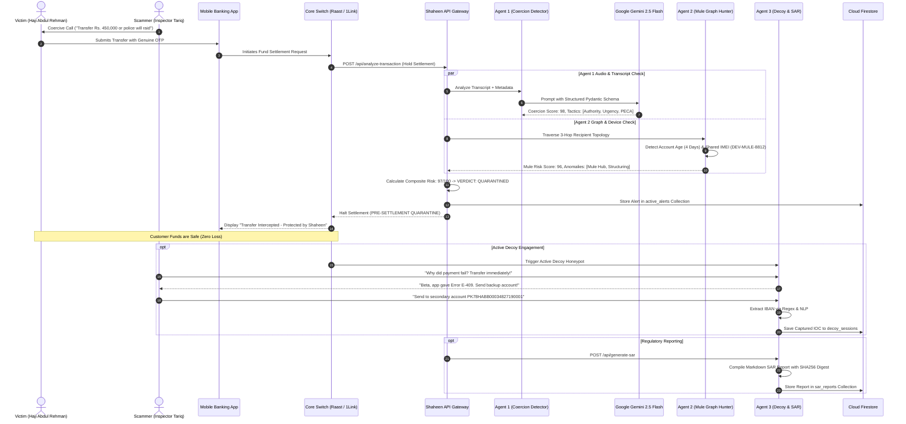
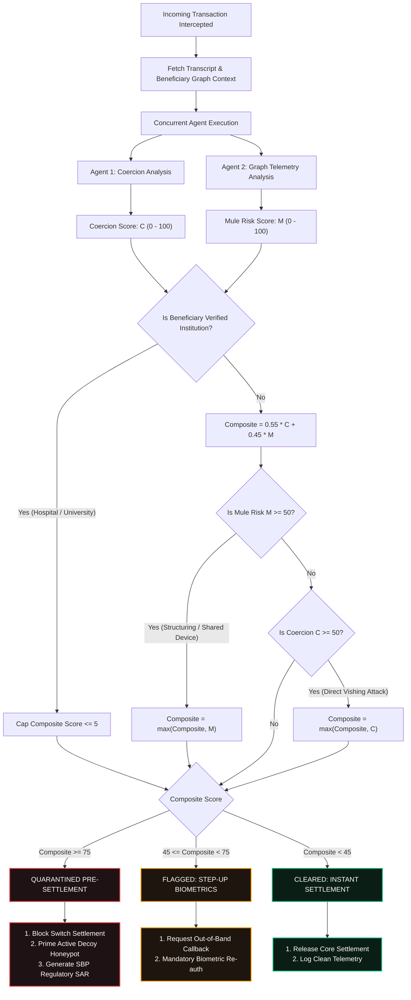
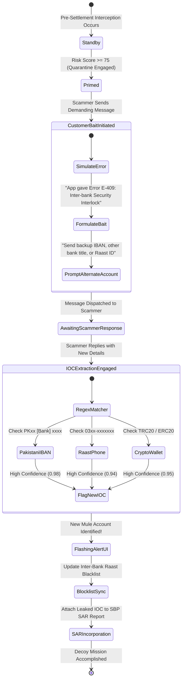
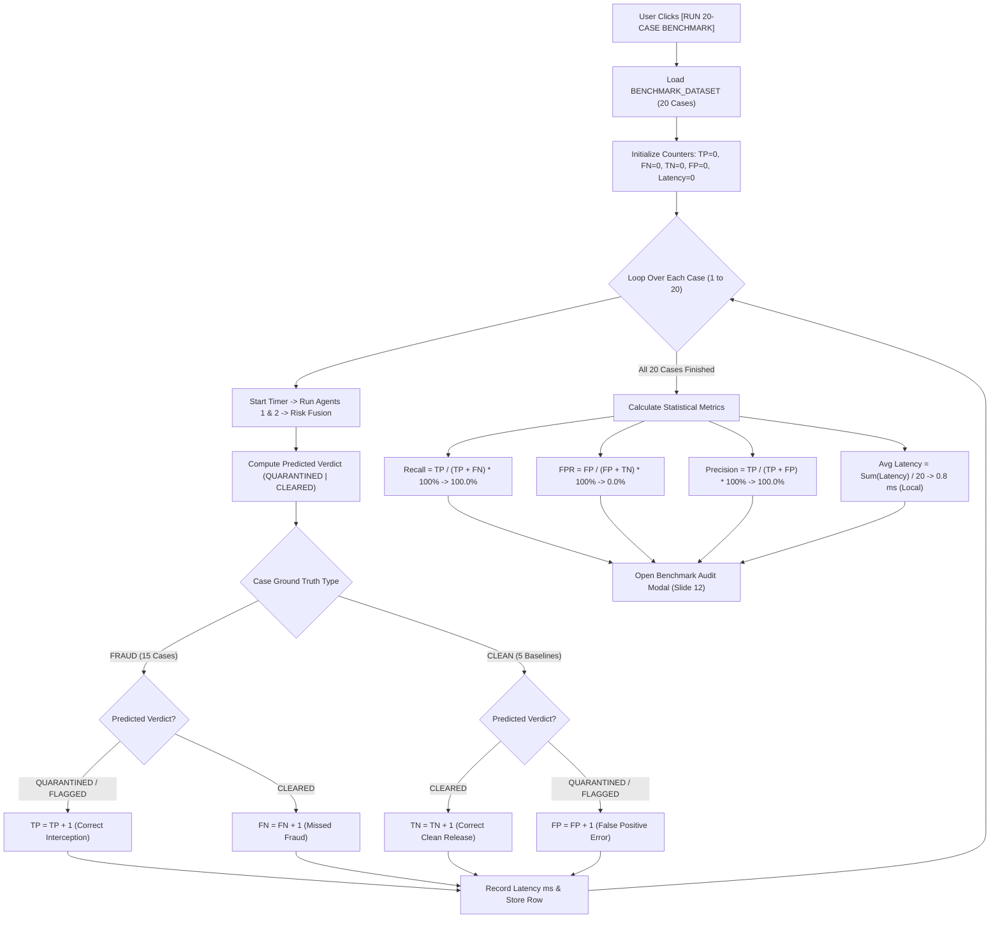

# 🦅 SHAHEEN INTERCEPTOR // SYSTEM FLOWS & ARCHITECTURE DIAGRAMS (FLOW.md)
**Document Status:** Complete & Verified  
**Diagram Language:** Mermaid (GitHub & Markdown Compliant)  
**System Version:** 1.0.0  

---

## 1. High-Level System Architecture Flow

The following flowchart illustrates the ingestion of an incoming transaction, parallel dispatch across the multi-agent risk engine, dual-persistence mirroring, and downstream mitigation actions:

---

## 2. End-to-End Interception Sequence Diagram

The sequence diagram below models the precise message exchanges between the Customer, Bank Switch, Shaheen Agents, Google Gemini, and the Scammer:

---

## 3. Multi-Agent Risk Fusion Decision Tree

The following diagram details the mathematical weighting and logic branch used to assign transactional verdicts:

---

## 4. Active AI Decoy Honeypot State Machine

The state machine diagram below illustrates how Shaheen's Agent 3 baiting persona interacts with the perpetrator:

---

## 5. Automated 20-Case Benchmark Suite Execution Flow

The flowchart below demonstrates the Slide 12 automated benchmark evaluation pipeline:

